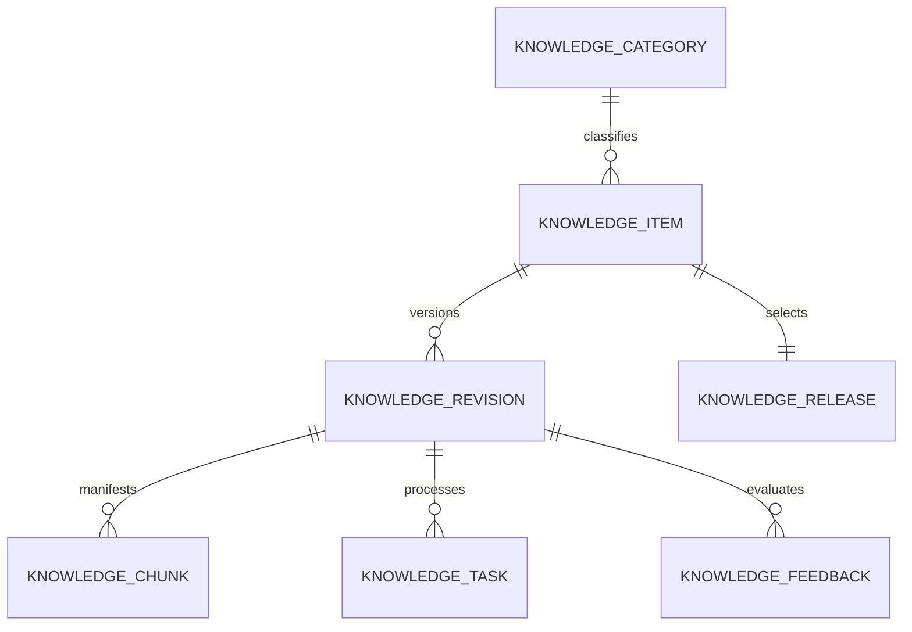

# MySQL 数据模型

首版 DDL 位于 [`scripts/g2rain-knowledge.sql`](../../scripts/g2rain-knowledge.sql)。该脚本创建独立库 `g2rain_knowledge`，仅用于首次初始化（会 `DROP` 并重建本库表），禁止在已有业务数据环境重复执行。模型遵循 G2rain 现有 MySQL 规范：`organ_id` 作为机构/租户隔离键，服务生成 `BIGINT` 主键，通用审计列为 `create_time`、`update_time`、`version` 与 `delete_flag`，且不使用物理外键。含 `delete_flag` 的索引统一使用 MySQL 函数键 `(IF(delete_flag = 0, 0, NULL))`，使唯一约束与查询索引仅作用于有效记录。

## 实体关系

## 表职责

| 表 | 职责 |
| --- | --- |
| `knowledge_category` | 组织级扁平运营分类字典；不承担权限、隔离或检索过滤 |
| `knowledge_tag` | 组织级扁平标签字典；`organ_id + tag_code` 唯一；`tag_name` 仅展示；不承担权限或数据隔离 |
| `knowledge_item` | 稳定知识主题，`organ_id + knowledge_key` 唯一；保存 `tags_json`、`priority`、分类与启停 |
| `knowledge_revision` | 文件或 FAQ 内容的版本、解析、索引和审核状态；保存 `embedding_profile` 与模型标识 |
| `knowledge_chunk` | 本地解析 chunks 与 Milvus Entity 的可重建清单，不保存正文；本表 `id` 直接作为 Milvus `chunk_id` 主键，不维护第二套向量记录 ID |
| `knowledge_task` | 可重试的知识处理任务；主路径为审核通过后的 `PROCESS`（解析、切片、Embedding、Milvus staged）；另有 `DELETE_INDEX`；不承载发布、回滚或下线 |
| `knowledge_release` | 每个知识主题当前活动 revision 的唯一权威选择 |
| `knowledge_answer_template` | 机构级回复模板；`template_code` 唯一，`ACTIVE` 模板可被 `/knowledge/answer` 选用 |
| `knowledge_feedback` | 客服回答反馈及人工修正线索 |

## 检索与发布查询约束

Milvus 的 `searchable` 标量字段是 `knowledge_release.active_revision_id` 的派生投影，用于避免生产检索携带大量 revision ID。检索服务必须按 `organ_id` 和 `delete_flag = 0` 批量校验 Milvus 返回的 chunk：它必须映射到同一机构、未删除且 revision 为 `knowledge_release.active_revision_id` 的 `knowledge_chunk`。Milvus 不具备发布裁决权。

人工发布操作先校验目标 revision 的 `index_status = INDEXED` 和 chunk 清单完整，在事务外预启用目标 Milvus Entity，再以 `knowledge_release.version` 做 CAS，在单个 MySQL 短事务内更新 `active_revision_id` 与 revision 状态。事务成功后同步关闭旧 Entity；任一步出现派生索引异常时，以 MySQL 活动版本复核兜底，并由人工索引对账命令修复。

`knowledge_task` 只服务知识处理。Worker 只领取 `PENDING` 且 `available_time` 已到的任务，领取时写入 `lease_owner` 与 `lease_expire_time`；租约过期的 `PROCESS` 或删除索引任务可恢复为待执行。

权威处理顺序为 `DRAFT → REVIEWING（人工审核原文/FAQ 与标签）→ APPROVED → PROCESS（解析、切片、Embedding、Milvus）→ READY_TO_PUBLISH → 人工同步发布`。审核只针对源内容，不审切片与向量中间产物；审核通过前不得写入 Milvus。DDL `revision_status` COMMENT 若仍列举旧状态词，以本页与业务流程为准，见 [DEV-001](deviations.md)。

`embedding_profile` 记录该 revision 实际使用的向量配置键（首期如 `qwen-4096-v1`），与部署中的 collection / 维度一一对应；`embedding_model` 记录外部模型标识。主题侧 `priority` 仅服务运营排序，不参与 Milvus 强制过滤。

## 标签模型

`knowledge_tag` 是组织级扁平标签字典。`tag_code` 是同一组织内的稳定业务键，创建后冻结，不得随展示名改写；`tag_name` 只用于运营端展示。标签是唯一的业务分类与检索筛选机制；它不承担租户隔离或权限职责，这些系统边界仍由 `organ_id`、发布状态和检索服务控制。

首版不建立标签关联表。运营端选择标签时，将 `tag_code` 数组写入 `knowledge_item.tags_json`；`PROCESS`/`INDEX` 从主题读取并同步至对应 Milvus Entity 的 `tags` ARRAY 字段。改已发布主题标签后需重新 PROCESS 才会更新向量侧。
