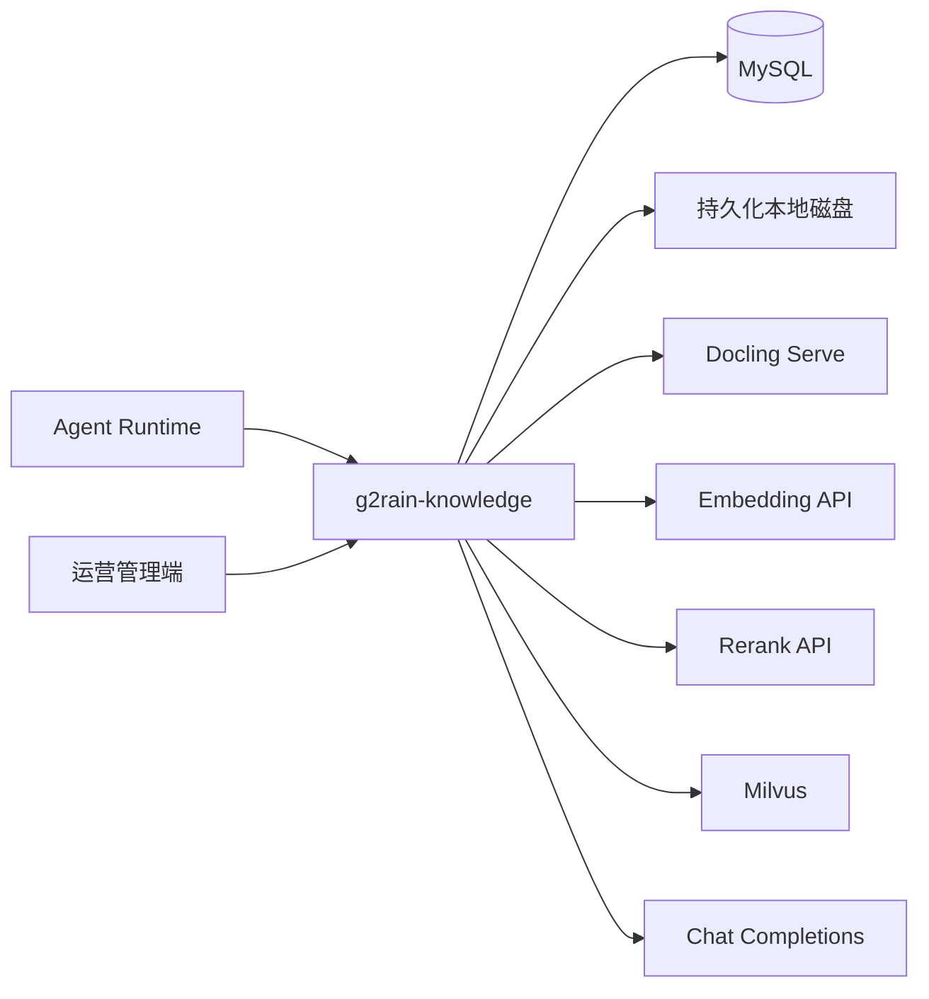

# 总体架构与职责

`g2rain-knowledge` 是知识域的业务入口。它对调用方屏蔽 Milvus collection、向量模型、解析服务和本地文件布局，并统一执行租户隔离（Starter）、版本裁决、发布状态、引用生成，以及基于可信证据的受控问答。

服务预期通过 `g2rain-deploy` 的内部网络使用 Docling、Milvus、Model Nexus 与 MySQL；这些基础设施不应直接暴露给 Agent Runtime 或运营管理端。文件根目录由 `KNOWLEDGE_STORAGE_ROOT` 指定，并挂载到持久化磁盘。

仓库已具备 API/Biz/Startup 三模块与领域主路径实现；部署与外部联调状态见 [project.yaml](../project.yaml) 与 [implementation-plan.md](../development/implementation-plan.md)。
